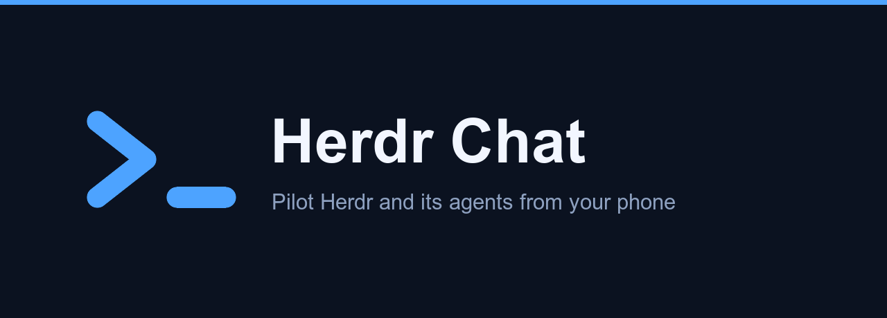

**Pilot Herdr.app and its agents from your phone.** Herdr Core Chat is a PWA that
talks to **herdr-core** (`hc`, the core behind Herdr.app), reads your agents'
sessions and lets you drive them from anywhere in your tailnet.

It is a separate app from **Herdr Chat** (the companion of the Herdr 0.9.3 TUI).
Both can run on the same machine at the same time: they share no port, no data
folder, no push keys and no service.

No SSH. No terminal on the phone. Nothing is copied out of your machine.

## What it does

- **Conversations, not terminals.** An agent's session is rendered as it actually
  reads: messages, thinking, tool calls, diffs, subagent results.
- **Answers you when you are not looking.** Push notifications say *"finished"*,
  *"needs you"* when an agent is waiting on a question, and *"error"* when it
  reports one.
- **Questions, with their choices.** When an agent blocks on a prompt, the real
  options are read off the screen and shown as buttons.
- **Send, answer, stop.** Through herdr-core's own API. A message is only shown as
  sent once the agent has actually started working on it; a refusal (for
  example an agent waiting on a permission decision) is shown as is.
- **Honest by default.** A missing value is shown as missing. An error carries its
  cause. Nothing is invented to fill a gap.

### Current limits

- **Conversations are resolved per agent.** herdr-core does not say which
  session file belongs to a terminal. Claude Code is resolved from its process
  (`~/.claude/sessions/<pid>.json`); codex and opencode from the session title
  they show in the terminal title, confirmed by their own index for that
  folder (exactly one match). Pi and devin are listed **without a
  conversation** until a reliable link is proven — never with a guessed one.
- **Launching agents** opens a new tab in a Herdr.app space: your machine's
  shell in the project folder, labelled so Herdr.app shows it, with the agent
  command typed in — as Herdr.app does itself. The installed agents are the
  CLIs found in the daemon's `PATH`. Launching outside a Herdr.app space is
  refused.

## Requirements

- **Herdr.app / herdr-core** on the same machine
  (`~/.local/state/herdr-core/default/default.sock`).
- **[Tailscale](https://tailscale.com)** for remote access. The server binds to
  `127.0.0.1` only — Tailscale Serve is the single supported way in.

## Install

```bash
brew trust xDelph/herdr-chat                  # the tap shared with Herdr Chat
brew install xDelph/herdr-chat/herdr-core-chat
brew services start herdr-core-chat
```

The service listens on `127.0.0.1:8792`; its log is
`$(brew --prefix)/var/log/herdr-core-chat.log`. Release and switch-over
procedure: [`docs/PACKAGING.md`](docs/PACKAGING.md).

Then expose it to your tailnet, on a port Herdr Chat does not use:

```bash
tailscale serve --bg --https=443 http://127.0.0.1:8792
```

Open `https://<your-machine>.<tailnet>.ts.net` on your phone and add it to the
home screen. It installs as its own app ("Herdr Core Chat").

Herdr Core Chat reads `tailscale serve status` at startup and allows the
origin that proxies to **its** local port, so there is nothing to declare by
hand. (Port 443 is omitted from that origin — browsers never send `:443`.)

## How it fits together

```text
iPhone ── Tailscale ── Serve :443 ── 127.0.0.1:8792 ── Herdr Core Chat
                                                            │
                                                            ├── herdr-core socket  (terminals, status, layout)
                                                            ├── Herdr.app state    (space and tab names)
                                                            └── session stores     (content)

iPhone ── Tailscale ── Serve :8790 ── 127.0.0.1:8791 ── Herdr Chat (Herdr 0.9.3, untouched)
```

**herdr-core stays the orchestrator.** Herdr Core Chat reads, displays and
forwards. Status comes from the programs themselves (OSC 7501, relayed by the
core); spaces and tabs come from the `herdr-app` doc of the core, and their
displayed names from `~/.config/herdr-app/workspace-state.json`. See
`docs/PROTOCOL.md` for what was measured.

## Configuration

Every variable is optional — a bare install works. The names of Herdr Chat
(`HERDR_REMOTE_*`, `HERDR_SOCKET_PATH`) are **never read**: Herdr 0.9.3 exports
`HERDR_SOCKET_PATH` in its panes.

| Variable | Default | Purpose |
|---|---|---|
| `HERDR_CORE_CHAT_SOCKET` | `~/.local/state/herdr-core/default/default.sock` | herdr-core socket |
| `HERDR_CORE_CHAT_HERDR_APP_STATE` | `~/.config/herdr-app/workspace-state.json` | Herdr.app names for spaces and tabs |
| `HERDR_CORE_CHAT_BIND` | `127.0.0.1` | Interface to bind. Never expose publicly. |
| `HERDR_CORE_CHAT_PORT` | `8792` | Local port (Herdr Chat uses 8791) |
| `HERDR_CORE_CHAT_PUBLIC_ORIGINS` | derived | Extra allowed origins, comma-separated |
| `HERDR_CORE_CHAT_LOG_PATH` | `~/.herdr-core-chat/herdr-core-chat.log` | Error journal |
| `HERDR_CORE_CHAT_PUSH_STORE` | `~/.herdr-core-chat/push.json` | Push subscriptions and VAPID keys |
| `HERDR_CORE_CHAT_READS_STORE` | `reads.json` next to the push store | Read marks shared across devices |
| `PI_SESSIONS_ROOT` | `~/.pi/agent/sessions` | Pi session root |
| `CODEX_SESSION_ROOT` | `~/.codex/sessions` | codex session root |
| `CLAUDE_PROJECTS_ROOT` | `~/.claude/projects` | Claude Code session root |
| `OPENCODE_DB` | `~/.local/share/opencode/opencode.db` | opencode session database |
| `DEVIN_DB` | `~/.local/share/devin/cli/sessions.db` | devin session database |

The VAPID key pair for push notifications is generated on first run and stored
alongside the subscriptions (never shared with Herdr Chat).
`HERDR_CORE_CHAT_VAPID_SUBJECT`, `HERDR_CORE_CHAT_VAPID_PUBLIC_KEY` and
`HERDR_CORE_CHAT_VAPID_PRIVATE_KEY` override it; `HERDR_CORE_CHAT_FILES_ROOTS`
adds readable file roots.

## Running from a checkout

The daemon is a single native binary, `herdr-core-chat` (Rust,
`crates/herdr_core_chat`), with the PWA embedded at build time. Bun is only
needed to **build** the PWA.

```bash
bun install --frozen-lockfile
bun run build                                        # apps/web/dist, embedded by the next step
cargo build --release --locked -p herdr_core_chat    # target/release/herdr-core-chat
bin/herdr-core-chat                                  # or: bun run start
```

`bin/herdr-core-chat` execs `target/release/herdr-core-chat` (else
`target/debug/herdr-core-chat`, or `HERDR_CORE_CHAT_BIN` when set).

## Development

```bash
nvm use          # reads .nvmrc
bun install
bun run verify   # web + shared: format → lint → typecheck → tests
cargo run --locked -p xtask -- verify   # Rust: layout, coverage, graph, fmt, clippy, tests
bun run dev      # Vite dev server
```

Tests never touch a real herdr-core: they use a fake core on a temporary
socket. Checks against herdr-core itself are run on an **isolated** core
(`HC_SESSION=<throwaway>` + temporary `XDG_*`), never on the user's — see
`AGENTS.md`. `docs/FINAL-GATE.md` lists the complete pre-release gate.

## License

[PolyForm Noncommercial 1.0.0](LICENSE). Free for personal and noncommercial use.
Commercial use requires a separate license.
